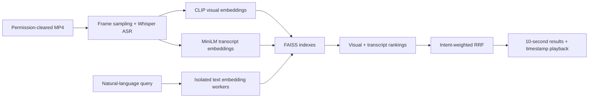

# Video Scene Search

[](https://github.com/naim-munshi/video-scene-search/actions/workflows/tests.yml?query=branch%3Amain)


**Find the right moment in a video using natural-language queries.** A local multimodal search prototype that aligns sampled image frames and transcribed speech with timestamped playback. Built for an AI engineering portfolio; not affiliated with ABEMA or any commercial video service.

**Start here:** [Engineering brief / 日本語概要](docs/RECRUITER_BRIEF.md) ·
[Fresh human-review evaluation](docs/HUMAN_EVALUATION.md) ·
[Historical real-video results](docs/LOCAL_RELEASE_RESULTS_2026-10-27.md) ·
[Source and tests](#repository-guide)

**Status:** `v0.1` local engineering release **PASS** (27 October 2026). Browser self-attestation, independent label verification and public hosting are **not** part of that PASS.

**Evaluation update:** a separate workflow now freezes fresh queries/splits,
records human review, and compares the hybrid with visual, transcript and
equal-weight RRF baselines. It includes paired bootstrap intervals and per-query
failures. **The tooling does not supply new human labels or claim improved accuracy.**

## At a glance

| Capability | Implementation |
| --- | --- |
| Scene search | CLIP ViT-B/32 visual similarity over sampled frames |
| Speech search | faster-whisper ASR + multilingual MiniLM text embeddings |
| Hybrid ranking | Query-intent weighted reciprocal rank fusion (RRF) |
| Index | FAISS, fixed 10-second windows, SHA-256 build manifest |
| Interface | Streamlit search, evidence thumbnails/transcripts, timestamp playback, local video import |
| Deployment boundary | Single-user Mac/Linux prototype; local media excluded from Git |

### Inspect the software without model downloads

```bash
git clone https://github.com/naim-munshi/video-scene-search.git
cd video-scene-search
python3 -m venv .venv
source .venv/bin/activate
python -m pip install "Pillow>=10,<13"
PYTHONPATH=src python -m unittest discover -s tests -v
PYTHONPATH=src python -m scene_search.cli --help
```

This runs the lightweight software checks. Native ML/video integration tests
remain optional; passing these checks does not establish semantic quality or
Safari playback. For the actual video UI, use the full setup below and your own
local media/index. For a fresh ground-truth study, follow the
[human evaluation guide](docs/HUMAN_EVALUATION.md); it reuses the existing index.

### Real-video engineering evidence

Three source-attributed videos (Steve Wozniak interview, *Tears of Steel* and NASA Apollo 15) were processed on the owner's Mac: **41:48 total**, **252 windows**, **1,256 sampled frames** and **453 speech segments**. Integrity and local H.264/AAC video/audio spot decoding **passed on 27 October 2026** for all three clips; the result is recorded in `reports/media-preflight-20261027-145120.json` on the Mac. Data and media are **not included** in this repository.

The six development and eighteen provisional test queries use **AI-assisted candidate relevance labels**, created from contact sheets and ASR. The following numbers are **exploratory weak-label retrieval measurements, not independent accuracy estimates**:

| Search method | Dev Recall@5 | Dev MRR@5 | Provisional test Recall@5 | Provisional test MRR@5 |
| --- | ---: | ---: | ---: | ---: |
| Visual | 0.3722 | 0.6667 | 0.3925 | 0.4676 |
| Transcript | 0.5167 | 0.5417 | 0.4159 | 0.4167 |
| **Hybrid** | **0.6333** | **0.8333** | **0.5224** | **0.5759** |

Hybrid provisional test Hit@5 was **0.7222 (13/18 queries)**. Failed or ambiguous results are documented in [the release analysis](docs/LOCAL_RELEASE_RESULTS_2026-10-27.md), including cases where modality fusion hurt ranking. Do not cite these values as independently verified model accuracy.

## Architecture



See [full architecture and security boundaries](docs/ARCHITECTURE.md).

## Run on the existing Mac collection

Requires the owner's **already-built** `artifacts/portfolio-real-v2` and Python virtual environment. Do not redownload or re-index existing media.

```bash
cd ~/video-scene-search
source .venv/bin/activate
git fetch origin main
git switch main
git pull --ff-only origin main

# Optional: verify existing source media decoding without changing it
python scripts/media_playback_preflight.py --index artifacts/portfolio-real-v2

# Launch the local-only UI
SCENE_INDEX=artifacts/portfolio-real-v2 python -m streamlit run app.py --server.address 127.0.0.1
```

Open the **URL printed by Streamlit** (for example `http://127.0.0.1:8502` if 8501 is already occupied). The **Video library** offers three playback checkpoints per source; the optional nine-checkpoint checklist now **retains confirmations across selections within the browser session**. It is a user self-attestation, **not** an automated Safari/browser PASS. Refreshing or closing the session may discard unchecked or unsaved observations.

## Setup from scratch (no bundled media)

Python 3.10–3.13, FFmpeg/FFprobe and adequate local storage are required. Python 3.12 is the known Mac configuration.

```bash
git clone https://github.com/naim-munshi/video-scene-search.git
cd video-scene-search
python3.12 -m venv .venv
source .venv/bin/activate
python -m pip install -e .
python -m unittest discover -s tests -v
```

To add your own video, record its provenance and permission in a manifest, then run `scene-search ingest --manifest examples/corpus.json --output artifacts/index`. **The example manifest must be edited and rights confirmed before use.** See the [developer guide](docs/DEVELOPER_GUIDE.md) for full ingestion steps, synthetic demo, MPS troubleshooting and reproducible evaluation.

## Final acceptance audit

After the owner's three-video local engineering release and media preflight have
both passed, check the evidence in one read-only command:

```bash
python scripts/final_acceptance.py
```

This automatically locates the most recent local release and media preflight
reports and distinguishes **engineering PASS** from **browser NOT_VERIFIED**.
Once all nine playback checks have genuinely been completed in Video Library,
the downloaded self-attestation can be reviewed separately:

```bash
python scripts/final_acceptance.py --browser-attestation ~/Downloads/browser-playback-self-attestation.json
```

Self-attestation is not third-party Safari certification or independently
verified ground truth; no user credentials or media are uploaded.
## Engineering quality and limitations

- **Evidence:** GitHub Actions checks Python compilation and dependency-light unit tests. Native FFmpeg/MPS and actual video playback are checked separately on the Mac.
- **Privacy:** original MP4s, frames, transcripts, FAISS indexes, evaluation labels and reports are git-ignored. Do not force-add private assets or third-party clips.
- **Accuracy:** CLIP may confuse similar scenes; ASR may miss dialogue; rank fusion can demote a valid match. Ten-second windowing and weak labels constrain Recall@5.
- **Safety:** local loopback only (`127.0.0.1`), XSRF protection enabled. **No authentication, multi-tenant access control or production hosting guarantee.**
- **Reproduction:** the index records model/package metadata and hashes, but model revisions are not fully pinned. Keep local caches and manifests for exact replay.

## Repository guide

| Resource | Purpose |
| --- | --- |
| [Engineering brief / 日本語概要](docs/RECRUITER_BRIEF.md) | Technical decisions, source tour and an honest interview summary |
| [Fresh human evaluation](docs/HUMAN_EVALUATION.md) | Freeze queries, record human review, compare four methods and analyze uncertainty |
| [Architecture](docs/ARCHITECTURE.md) | Component diagram, search pipeline and data contracts |
| [Local release audit](docs/LOCAL_RELEASE_RESULTS_2026-10-27.md) | Provenance, metrics, limitations and failure cases |
| [Project closure](docs/PROJECT_CLOSURE.md) | Phase status, evidence and outstanding external sign-offs |
| [Developer guide](docs/DEVELOPER_GUIDE.md) | Ingestion, CLI, benchmarks and platform troubleshooting |
| [বাংলা quickstart](docs/QUICKSTART_BN.md) | Bangla setup and existing Mac instructions |
| [Security review](docs/SECURITY_REVIEW.md) | Threat model, safeguards and out-of-scope risks |
| [Demo storyboard](docs/DEMO_RECORDING.md) | Rights-aware 80-second demo recording plan |
| [Contributing](CONTRIBUTING.md) / [Security policy](SECURITY.md) | Development and vulnerability reporting guidance |

## Usage and attribution

Third-party footage has distinct rights and attribution requirements; verify them before reproducing screenshots, faces, music or clips. See [video source catalogue](docs/VIDEO_SOURCES.md). No third-party video is distributed here. A code reuse license has **not been specified** in this repository; do not assume an open-source license applies.
