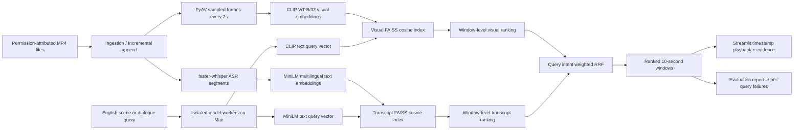

# Architecture — Video Scene Search v0.1 local portfolio release

**Scope:** single-user, offline-capable Mac research prototype, not
authenticated/public video hosting. This diagram documents implemented
code paths and separates indexing, query, UI and evaluation.

## Data contracts

- A video has an ID, title, local path, recorded source/license/attribution
  and an explicit owner/rights declaration.
- The canonical search unit is a ten-second window (`video_id:00000`).
- Frames sampled approximately every 2 seconds map to a window ID.
- Whisper speech segments may overlap multiple consecutive windows.
- Each FAISS index uses normalized embeddings and inner-product similarity.
- Visual window score = the maximum sampled-frame cosine for that window;
  transcript window score = the maximum overlapping segment cosine.
- RRF combines rank positions without adding incompatible cosine scores.
  Query-intent weights are heuristic, not trained or independently validated.
- Search displays the source video, timestamps, representative image and
  overlapping transcript, and indicates that ranking score is NOT probability.

## Implementation map

| Module | Responsibility |
| --- | --- |
| `src/scene_search/pipeline.py` | Ingest, ASR, frame sampling, model embedding, atomic index publication |
| `src/scene_search/extend.py` | Incrementally append a video to a new index without changing the old one |
| `src/scene_search/search.py` | Validate index hashes, load FAISS, rank query embeddings, timestamped retrieval |
| `src/scene_search/core.py` | Shared IDs, fixed windows, weighted RRF and exact-window metrics |
| `src/scene_search/query_worker.py` | Isolated batch query embedding with MPS/CPU and local cache option |
| `src/scene_search/evaluate.py` | Provenance-aware Recall@5/Hit@5/MRR@5, failure and ceiling analysis |
| `app.py` | Local-only Streamlit search, annotation, video library and import UI |
| `scripts/finish_portfolio.py` | Audited dev/test engineering release and shareable textual evidence archive |
| `scripts/media_playback_preflight.py` | Read-only video/audio stream and spot-decode checks; NOT a Safari test |

## Reproducibility and security boundaries

- Source videos, FAISS indexes, speech transcripts and reports remain in
  Git-ignored local folders; they are not uploaded with the source repository.
- SHA-256 files-manifest validation detects accidental/local changes but is
  not a signature proving trust in the original source.
- Model revisions are not immutable/pinned for strict scientific replay;
  keep index/build hashes and cached model versions with private evidence.
- Hugging Face models can run from local cache with `--offline`; no TLS
  validation is disabled.
- Streamlit is configured for `127.0.0.1` with XSRF protection. The
  local importer does not auto-execute indexing. No multi-user auth or
  protected cloud storage is implemented.
- The local video stream decode checker and manual playback checklist
  provide separate evidence; neither proves independently verified labels.

## Evaluation methodology

The 24-query portfolio package (6 dev/18 provisional test) was created
with AI-assisted candidate window labels based on sampled frames and ASR.
Therefore measured scores are exploratory and should not be called
independently labeled retrieval performance. On 27 Oct 2026 the owner's
Mac release reported hybrid test Recall@5 = 0.5224 and MRR@5 = 0.5759
**against these weak labels**. Both splits have been inspected, so new
tuning requires a fresh untouched test set if a blind estimate is desired.
See `docs/LOCAL_RELEASE_RESULTS_2026-10-27.md` for the full audit.

## Closeout status

Repository and Mac engineering release: **complete for local portfolio
proof-of-concept scope**. Independent human annotation, nine Safari
picture/sound checkpoints and media demo recording are separate optional
publication/validation sign-offs; not claimed as complete.
